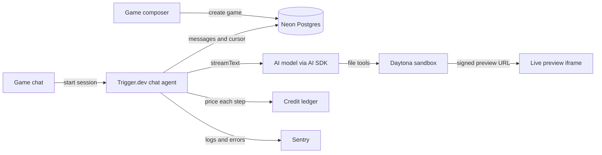

<div align="center">

# OGame

**Describe a game. Get a playable 3D game.**

An AI-powered platform that turns a conversation into a real, editable 3D game that runs in your browser.

[Features](#features) · [How It Works](#how-it-works) · [Stack](#stack) · [Getting Started](#getting-started) · [Project Structure](#project-structure) · [Scripts](#scripts)

</div>

---

<!-- Add a screenshot or a short GIF of a generated game here -->

## Overview

OGame lets anyone create a 3D game by writing what they want in plain language. A chat agent asks a few design questions, writes the game code with a pre-trained language model, and runs it in an isolated cloud sandbox. The result shows up live in a preview next to the chat, and you can keep improving it with follow-up messages such as "make the player faster" or "add enemies".

Everything is organized by **organization**, not by single user. Games, credits and subscriptions belong to the organization, so a team, a class or a studio can work together on the same space.

## Features

- **Prompt to 3D game** - Describe an idea and get a playable game built on a three.js engine toolkit.
- **Guided briefing** - The agent asks one design question at a time, and each answer resumes the run exactly where it stopped.
- **Live preview** - The game runs in its own cloud sandbox and is shown in an iframe through a signed preview URL.
- **Iterate by chat** - Change the game at any time by continuing the conversation.
- **Three AI models** - Pick between **Astra**, **Sol** and **Luna** from the message composer.
- **Durable and resumable** - Long runs survive closed tabs, slow connections, power cuts and empty batteries, and a reload resumes an interrupted stream.
- **Organizations** - Sign in with email, Google or one-time passcode (OTP), then work inside an organization.
- **Usage-based credits** - Every model step is priced by token class and charged to the organization's credit ledger.
- **Production monitoring** - Errors and logs from the frontend, server, edge and background worker are sent to Sentry.

## How It Works



1. **Create** - The home page composer saves a new game to Postgres and opens its chat with the prompt auto-submitted.
2. **Sandbox** - The first turn creates a Daytona sandbox and seeds it with the runtime and the three.js engine toolkit.
3. **Brief** - The agent asks one design question at a time, and each answer resumes the turn where it stopped.
4. **Build** - The model writes and edits game files through sandboxed tools, with tool calls streamed to the chat.
5. **Preview** - A server route starts a static server in the sandbox and returns a signed preview URL for the iframe.
6. **Persist** - Each completed turn stores the messages and the session cursor, so a reload resumes an interrupted stream.
7. **Bill** - Every model step is priced by token class and charged to the organization's credit ledger.

## Credits and Billing

| Plan             | Price | Credit             |
| ---------------- | ----- | ------------------ |
| Free trial       | $0    | $1 per organization |
| Subscription     | $20   | $10 of extra credit |

Credits are tracked per organization in a ledger, and every model step is charged according to the model used and the tokens consumed. Authentication, organizations and subscription billing are handled by Clerk.

## Why These Choices

| Need                                             | Solution     |
| ------------------------------------------------ | ------------ |
| Long-running generations with retries            | Trigger.dev  |
| Running AI-written code safely, away from our servers | Daytona sandboxes (own filesystem, own Linux OS, own storage) |
| Surviving power cuts, slow networks, low battery | Durable Trigger.dev runs and resumable streams |
| Auth, organizations and payments without building them | Clerk   |
| Typed database access and cheap branching        | Drizzle on Neon |
| Seeing problems before users report them         | Sentry       |

## Stack

| Technology                 | Purpose                                                        |
| -------------------------- | -------------------------------------------------------------- |
| Next.js 16 and React 19    | Application framework and interface                            |
| AI SDK                     | Streaming chat, tool calling, and the model provider           |
| Trigger.dev                | Durable chat agent runs, resumable streams, and retries        |
| Daytona                    | Per-game cloud sandboxes and signed preview URLs               |
| three.js                   | 3D rendering inside the seeded game engine                     |
| Clerk                      | Authentication, organizations, and subscription billing        |
| Neon and Drizzle           | Serverless Postgres and typed database access                  |
| Sentry                     | Frontend, server, edge, and worker monitoring with source maps |
| shadcn/ui and Tailwind CSS | UI components and styling                                      |

## Getting Started

### Prerequisites

- Node.js 20 or later
- A Neon database
- A Clerk application with organizations and billing enabled
- A Trigger.dev project
- A Daytona account
- A Sentry project
- An API key for your AI model provider

### Installation

```bash
git clone https://github.com/MiradoAndreas/ogame.git
cd ogame
npm install
```

### Environment variables

Create a `.env.local` file at the root of the project. The exact names depend on your setup, so adjust them to match your configuration.

```bash
# Database (Neon)
DATABASE_URL=

# Authentication and billing (Clerk)
NEXT_PUBLIC_CLERK_PUBLISHABLE_KEY=
CLERK_SECRET_KEY=

# Background tasks (Trigger.dev)
TRIGGER_SECRET_KEY=

# Sandboxes (Daytona)
DAYTONA_API_KEY=

# Monitoring (Sentry)
SENTRY_DSN=

# AI model provider
AI_API_KEY=
```

### Run locally

```bash
# Push the Drizzle schema to your database
npm run db:push

# Start the Next.js development server
npm run dev

# In a second terminal, start the Trigger.dev worker
npm run trigger:dev
```

Open [http://localhost:3000](http://localhost:3000), sign in, create an organization and describe your first game.

## Project Structure

```text
app/
├── (app)/                      # Home composer, game page, and billing page
├── api/games/[id]/preview/     # Starts the sandbox server and signs a preview URL
├── sign-in/                    # Clerk sign-in
└── sign-up/                    # Clerk sign-up
components/
├── app-sidebar.tsx             # Games list, credits, organization and user menus
├── chat-composer.tsx           # Message input with model picker
├── chat-preview.tsx            # Live game iframe and runtime error reporting
├── chat-thread.tsx             # Streamed messages, tool calls, and briefing questions
├── game-chat.tsx               # Chat transport wiring and preview refresh
├── new-game-composer.tsx       # Home page prompt and suggestions
└── ui/                         # Shared UI primitives
lib/
├── billing/                    # Credit ledger, per-token pricing, and Clerk Billing reconciliation
├── daytona/                    # Sandbox creation, lookup, deletion, and preview server
├── db/                         # Drizzle schema and Neon client
├── games/
│   ├── instructions/           # Agent system prompt: workflow, runtime, and engine
│   ├── runtime/                # Files seeded into every sandbox, including the engine
│   ├── actions.ts              # Create, rename, and delete games
│   ├── chat-actions.ts         # Chat session start and token minting
│   ├── chat-store.ts           # Message and session persistence
│   ├── model-catalog.ts        # Selectable models and their copy
│   └── tools.ts                # Sandboxed file tools and ask_player
└── observability.ts            # Shared Sentry logger for app and worker
trigger/
├── chat.ts                     # The game-chat Trigger.dev chat agent
└── init.ts                     # Sentry setup and lifecycle hooks for the worker
neon.ts                         # Neon branch policy
trigger.config.ts               # Trigger.dev build and deploy configuration
```

## Scripts

| Command                  | Description                                      |
| ------------------------ | ------------------------------------------------ |
| `npm run dev`            | Start the Next.js development server             |
| `npm run build`          | Create a production build                        |
| `npm start`              | Start the production server                      |
| `npm run lint`           | Run ESLint                                       |
| `npm run format`         | Format TypeScript and TSX files with Prettier    |
| `npm run typecheck`      | Run TypeScript without emitting files            |
| `npm run db:push`        | Push the Drizzle schema directly to the database |
| `npm run db:studio`      | Open Drizzle Studio                              |
| `npm run trigger:dev`    | Start the Trigger.dev development worker         |
| `npm run trigger:deploy` | Deploy tasks to Trigger.dev                      |

## Deployment

1. Deploy the Next.js app to your hosting provider (for example Vercel) with the same environment variables.
2. Deploy the background tasks with `npm run trigger:deploy`.
3. Make sure your Clerk, Neon, Daytona and Sentry projects point to production values.

## Roadmap

- Public links to share finished games
- A gallery of starter game templates
- Real-time collaboration inside an organization
- Generated sound and music
- Export for mobile

## Contributing

Contributions are welcome. Open an issue to discuss a change, then submit a pull request. Please run `npm run lint` and `npm run typecheck` before pushing.

## License

Add your license here (for example MIT) and include a `LICENSE` file at the root of the repository.
